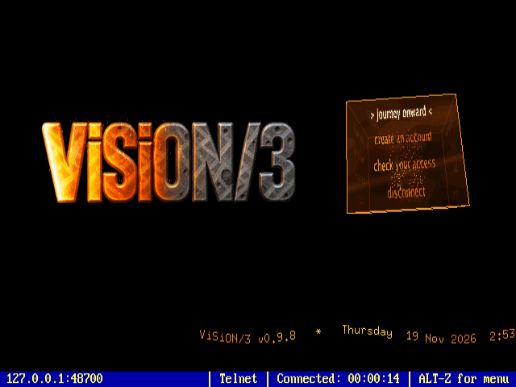
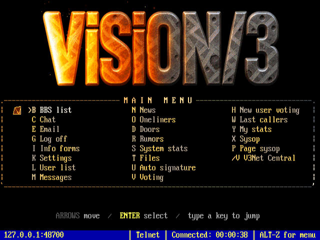
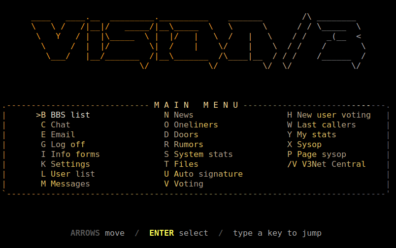
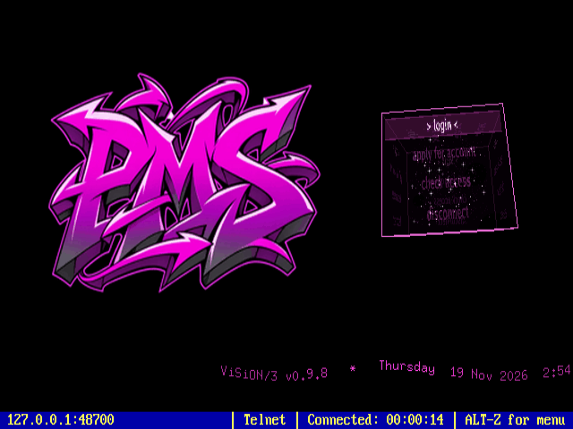
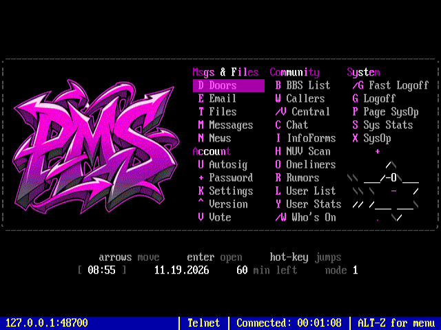

# Preview: scripted menus, sixel pictures and two example themes

This is what I've been building on my board, Pirate Mind Station, pulled
onto a branch so you can run it. I wanted to show you and hear what you
think. I'm not asking you to merge it. If any of it looks like something
ViSiON/3 should have, tell me which parts and we can work out how.

It's cut from `main` at `59dd669d`.

## What is in it

| Capability | Docs |
|------------|------|
| A `.MNU` names a script that draws the menu and answers its prompt; `menuScript` in `theme.json` does it for every menu; `LABEL` on commands | [Menus drawn by a script](docs/sysop/scripting/vpl-scripting.md#menus-drawn-by-a-script), [Scripted Menus and Themes](docs/sysop/scripting/scripted-themes.md) |
| A `SCRIPT` ending in `.js` runs from the theme's own `scripts/`, with no `doors.json` entry | [Theme scripts](docs/sysop/scripting/vpl-scripting.md#theme-scripts) |
| Built-in screens drawn by a theme's script: User Konfig, Twit List, User List, Fast Logon, Your Stats | [Menus drawn by a script](docs/sysop/scripting/vpl-scripting.md#menus-drawn-by-a-script) |
| Pictures (`v3.gfx.image`) and a pixel canvas (`v3.gfx.canvas`), sent as sixel | [v3.gfx](docs/sysop/scripting/vpl-scripting.md#v3gfx) |
| Sixel, audio and encoding read from the terminal's answers at connect, never its name. A sixel or audio answer that comes after the 750 ms wait still counts, and so does a late encoding answer while the login matrix is up | [v3.gfx](docs/sysop/scripting/vpl-scripting.md#v3gfx), [Encoding](docs/sysop/advanced/encoding.md), [Pre-Login Matrix](docs/sysop/menus/menu-system.md#pre-login-matrix-screen) |
| Two shipped scripted themes: ViSiON3-Sixel (`menus/vision3`) and PMS (`menus/pms`) | [menus/vision3/README.md](menus/vision3/README.md), [menus/pms/README.md](menus/pms/README.md) |
| Pre-login screens (connection check, login matrix) owned by the board in `prelogin/`, with a picture, a turning cube, two tones and an optional tune; two example sets in `templates/` | [Pre-login screens](docs/sysop/configuration/adding-a-theme.md#pre-login-screens) |
| Per-theme `strings.json`, a theme name and description in Konfig, `./vision3 doctor --theme` | [Theme Strings](docs/sysop/configuration/configuration.md#theme-strings), [Name and description](docs/sysop/configuration/adding-a-theme.md#name-and-description), [Checking a theme](docs/sysop/configuration/adding-a-theme.md#checking-a-theme) |
| A test-account flag: its logins leave no caller history and are not announced | [Test Accounts](docs/sysop/users/user-management.md#test-accounts) |
| Panic recovery in session goroutines (`internal/safego`) | none |
| A Hello door: an animated greeting on the sixel canvas, ANSI elsewhere, with a tune where the terminal plays sound; `v3.gfx.audio`; a login step that runs for one theme only | [The Hello door](docs/sysop/scripting/vpl-scripting.md#the-hello-door-hello-vision3js), [Login sequence](docs/sysop/users/login-sequence.md) |
| A source engine that copies Reddit, Hacker News, NASA GCN and NNTP groups into message areas. The template's one Reddit feed and three NNTP groups are disabled, and so is its sync event | [Source Gateway](docs/sysop/messages/source-gateway.md), [NNTP](docs/sysop/messages/nntp.md) |

## What it looks like

Captured from a board built from this branch with the commands under
[Try it](#try-it). SyncTERM 1.9 draws sixel; xterm 390 does not.

### ViSiON3-Sixel



The login matrix from `templates/prelogin-example/`, on SyncTERM: the logo picture beside the turning cube with the four choices.



The main menu on SyncTERM: the sixel logo over the framed menu, with the small cube beside the selected command.



The same main menu on xterm, which does not draw sixel: the text logo, no cube.

### PMS



The login matrix from `templates/prelogin-example-pms/`, on SyncTERM: the graffiti picture beside the pink cube with glitter.



The PMS main menu on SyncTERM: the graffiti picture, three columns of commands and the star mascot.

## Try it

These commands were run on a fresh clone on Linux, with Go and `jq`
installed. They clone into your home directory, which `SRC` relies on. The
`jq` line selects the ViSiON3-Sixel theme and makes the board listen on
127.0.0.1 only.

```bash
cd ~
git clone -b feat/scripted-menus-sixel-preview https://github.com/ViSiON-3/vision-3-bbs.git vision-3-preview
cd vision-3-preview
./dev-setup.sh ~/v3-preview
cd ~/v3-preview
SRC=~/vision-3-preview
jq '.theme = {"name": "vision3"} | .sshHost = "127.0.0.1" | .telnetHost = "127.0.0.1"' configs/config.json > configs/config.json.new && mv configs/config.json.new configs/config.json
mkdir -p prelogin && cp -R "$SRC/templates/prelogin-example/." prelogin/
./vision3 doctor --theme vision3
./vision3
```

- `doctor --theme vision3` ends with
  `ALL CHECKS PASSED  36 passed  ·  0 warning(s)  ·  0 failure(s)`.
- A plain `./vision3 doctor` passes `pre-login` (`7 from prelogin/, the rest
  from menus/v3`) and warns 5 times about the fresh install: the default
  sysop password, `binkd.conf` placeholders, and the permissions of
  `ftn.json`, `doors.json` and `qwknet.json`.
- Connect with telnet to 127.0.0.1 port 2323 (SyncTERM:
  `telnet://127.0.0.1:2323`) and log in as `felonius`, password `password`.

To switch the board to the PMS theme and its pre-login set, stop the board
(Ctrl-C) and run, from `~/v3-preview`:

```bash
jq '.theme.name = "pms"' configs/config.json > configs/config.json.new && mv configs/config.json.new configs/config.json
cp -R "$SRC/templates/prelogin-example-pms/." prelogin/
./vision3 doctor --theme pms
./vision3
```

- `doctor --theme pms` warns once for each of the seven game doors (see
  [below](#what-a-stock-board-lacks-for-the-pms-theme)) and passes the rest:
  `CHECK WARNINGS  40 passed  ·  7 warning(s)  ·  0 failure(s)`.
- Going back to the first pre-login set, delete `prelogin/strings.json` and
  `prelogin/ansi/PDMATRIX.MUSIC.WAV` as well; only the PMS set has them, and
  the tune would otherwise play on the ViSiON/3 matrix.
- A caller can also pick either theme in Konfig without a restart; the
  pre-login set is the board's and does not change with it.

## What to look at, in order

| Step | Sixel terminal (SyncTERM) | Plain terminal (xterm) |
|------|---------------------------|------------------------|
| 1. The login matrix, on connecting | The ViSiON/3 logo picture beside a turning amber cube carrying the four choices | FIGlet lettering and a four-line lightbar |
| 2. The main menu: log in, press a key to leave the Hello door (it opens login on this theme), then `2` at Fast Logon | The logo picture over a framed three-column menu, a small turning cube beside the selected command | A FIGlet text logo over the same menu, no cube |
| 3. `K` for Konfig, then `V` for Theme | A list of themes, with a line describing the highlighted one; Enter applies it at once | The same |
| 4. Pick PMS, then `Q` | Konfig is redrawn by the PMS script; `Q` gives the PMS main menu: a graffiti picture, three columns of commands, a star mascot | Konfig the same; the main menu with a dotted text logo in place of the picture |
| 5. A scripted built-in screen | In PMS, Konfig (step 4) and, at the next login, Fast Logon are drawn by the theme's `submenu.js`; both are text | The same |

With the board on the PMS pre-login set, the matrix shows the graffiti
picture beside a pink cube on SyncTERM, and a text matrix with keys `L`,
`A`, `C` and `D` on xterm.

The login matrix and the ViSiON3-Sixel main menu animate while they wait.
A picture frame goes out only once the terminal has answered for the one
before last, so a slow terminal gets fewer frames and no backlog. To a
scripted sixel terminal on the same machine the ViSiON/3 matrix sent about
13 frames and 270,000 bytes a second.

## The Hello door

`D` then `H` from the main menu, in any of the three themes. On a sixel
terminal it is an animated canvas: the logo lands, the caller's handle fades
up and away, then a sine scroller with their details runs over copper bars
and a starfield. On other terminals it is ANSI block lettering and a text
scroller. It is all in `scripts/hello-vision3.js`; the only engine change
for it is `v3.gfx.audio`, which tells a script whether the terminal answered
the audio query. Where it did, the door plays a two-minute tune of mine from
`scripts/data/hello-vision3-tune.b64` (3.5 MB, sent to the caller after the
first frame). Any key leaves.

The stock login sequence runs it first for a caller on the ViSiON3-Sixel
theme and for nobody else: a login step can have a `"theme"`, and
`templates/configs/login.json` opens with
`{"command": "DOOR:HELLO", "theme": "vision3"}`.

## Terminals

| Terminal | Its answer at connect | What the board did |
|----------|-----------------------|--------------------|
| SyncTERM 1.9, Linux, telnet | `ESC[<0;1;2;3;4;5;6;7c` and `ESC[=67;84;101;114;109;1;326c`; no answer to the audio queries | sixel on, audio off, CP437 |
| xterm 390, telnet | `ESC[?64;1;2;6;9;15;16;17;18;21;22;28c`; no answer to the audio queries | sixel off, audio off, UTF-8 |

The matrix tones are sent only to a terminal that answers yes to both audio
queries (libsndfile present, 8-bit WAV playable). Neither terminal above
answers yes. SyncTERM 1.10b on macOS does, and I have heard the tones there.
The PMS set also plays a 28-second tune of mine, "Pirate Mind Ship", once
the picture has drawn its opening; when it ends the cube stops turning and
faces you.

## What a stock board lacks for the PMS theme

Its Doors menu names seven games that do not ship: `DANK`, `USURPER`,
`LORD`, `LORD2`, `SYNCDOOM`, `OOII` and `CARRIER`. Choosing one sends
`Error: Door 'LORD' is not configured.` and returns to the Doors menu. The
theme's two other doors, `PAUSEBAR` and `AMILC`, are in the stock
`doors.json`.

## Rough edges I know about

- A missing door's message is drawn over at once instead of waiting for Enter, on every theme.
- `doctor --theme` checks that a `RUN:` command exists, not that the theme has the screens it reads: a theme without `ansi/YOURSTAT.ANS` passes, and `RUN:SHOWSTATS` then fails.
- `doctor --theme` does not check that a string's `!CODE` names a defined door.
- `v3.session.timeLeft` reads 3600 for a caller with no time limit, so the PMS footer shows `60 min left` to the sysop.
- PMS `submenu.js`: a label that is not selected is not cut to its column width, so a long one runs into the next column (found by reading the code).
- PMS `userlist.js` draws an 80x24 layout on a smaller terminal (found by reading the code).
- On SyncTERM, the unselected choices on the PMS matrix cube are hard to read at the board's real size.
- `setup.sh` runs `ssh-keygen` before it creates `configs/`, so on a fresh clone the SSH host key is not written and the board will not start. This is also on `main`, where pull request #1131 fixes it; `dev-setup.sh`, used above, is not affected.

## Size

Measured at the branch head against `59dd669d`:

| | Files | Lines |
|-|-------|-------|
| Everything | 760 changed, 588 of them new | +41,647, -1,054 |
| Go code | 146 | +13,363, -752 |
| Go tests | 106 | +14,867, -95 |
| Theme files (`menus/vision3`, `menus/pms`) | 409 (199 and 210) | |
| Scripts (`.js`) | 13 | +6,089 |

About half of the Go is tests that came over with the code from my board.
I wouldn't ask you to take those as they are.

## If you want any of it

Say which parts. It comes apart into small pieces, and this is roughly the
order they build on each other:

1. Scripted menus: a `.MNU`'s `SCRIPT` names a `v3_script` door that draws the menu; `v3.menu.items`, `LABEL`, `v3.prompt.answer`, and the fallback to the `.ANS`.
2. Theme script folders: a `SCRIPT` ending in `.js` runs from the theme's `scripts/`, and `menuScript` in `theme.json`.
3. More `v3.menu` fields (`name`, `title`, `shortcuts`, `expand`) and `v3.util.fitColumns`.
4. The ViSiON3-Sixel example theme, which draws its text version until step 5 is in.
5. `v3.gfx`, the pixel canvas and sixel detection from the terminal's answer.
6. Toasts and the time-left warning inside a scripted menu.
7. Konfig and the other built-in screens drawn by scripts.
8. The login matrix picture, cube and tones.

Steps 2 and 5 touch what issue #623 covers: a theme script's own data
directory, running theme scripts with no run limit, and picture reads. Those
would follow whatever you decide there.

I haven't worked out where the PMS theme, the pre-login example sets,
per-theme strings and names, `doctor --theme`, the test-account flag, panic
recovery and the source engine would go in that list.
