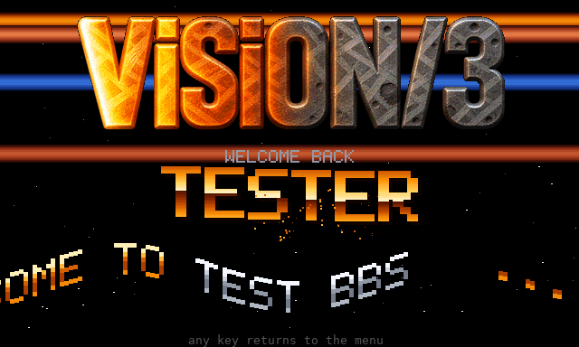
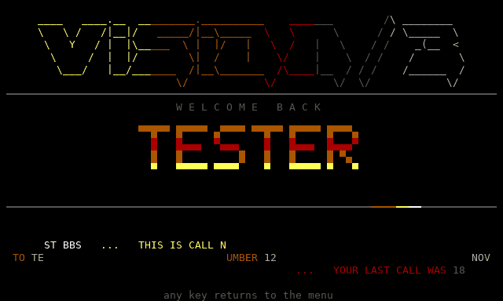

# VPL Scripting

VPL (Vision Programming Language) is ViSiON/3's built-in scripting system. It lets sysops write custom doors, utilities, and interactive features in JavaScript using a BBS-specific API — without external programs, compilers, or dependencies.

## What It Is

VPL scripts are JavaScript files that run inside the BBS process using the `v3.*` API. The engine is powered by [goja](https://github.com/dop251/goja), the same pure-Go JavaScript engine used for [Synchronet JS doors](doors/synchronet-js-doors.md), but with a clean Vision/3-native API instead of Synchronet's compatibility surface.

Each user who runs a VPL script gets their own isolated runtime. Scripts have access to terminal I/O, the user database, message areas, file areas, and persistent storage — all through the `v3.*` namespace.

### VPL vs. Synchronet JS Doors

| | VPL Scripts | Synchronet JS Doors |
|---|---|---|
| API namespace | `v3.*` | `console.*`, `bbs.*`, `user.*` |
| Purpose | Custom Vision/3 features | Run existing Synchronet games |
| Color codes | Vision/3 pipe codes (`\|07`, `\|15`) | Synchronet Ctrl-A codes |
| Door type | `v3_script` | `synchronet_js` |
| External files needed | None | Synchronet exec/load libraries |

Both use the same underlying JavaScript engine (goja) and the same session isolation model.

## Why It's Useful

- **No external tools** — scripts run inside the BBS process, no compilation or external runtime needed
- **Full BBS access** — read/write users, post messages, search files, persist data
- **Familiar language** — JavaScript (ES5.1+ with classes, arrow functions, template literals)
- **Per-user isolation** — each session gets its own runtime, no shared state leaks
- **Hot reload** — edit a script file, run it again immediately. No restart required
- **Persistent storage** — built-in key-value store for script data

### Common Use Cases

- Oneliners wall
- Voting booths
- Auto-message of the day
- System statistics displays
- Top callers / top posters
- Last 10 callers
- Custom user surveys
- BBS-specific mini-games
- Automated maintenance tasks

## Directory Structure

```
scripts/                       Root for all VPL scripts
├── data/                      Persistent data (v3.data storage)
│   ├── hello.json             Auto-created per-script JSON stores
│   └── voting.json
├── hello-vision3.js           The stock HELLO door
└── examples/                  Shipped example scripts
    └── hello.js
```

| Path | Purpose |
|------|---------|
| `scripts/` | Place your `.js` script files here. Organize freely with subdirectories. |
| `scripts/data/` | Automatic storage for `v3.data` and the sandbox for `v3.fs`. Each script gets a JSON file named after the script (e.g., `voting.json` for `voting.js`). Do not edit these manually while the BBS is running. See [How the store is kept on disk](#how-the-store-is-kept-on-disk) for what happens to a damaged or read-only store. |
| `scripts/examples/` | Shipped example scripts for reference. |

## Adding a VPL Script

### 1. Write the Script

Create a `.js` file in `scripts/` (or a subdirectory):

```javascript
// scripts/greeting.js
v3.console.clear();
v3.console.println("|11Welcome, |15" + v3.user.handle + "|11!");
v3.console.println("|07You have called |15" + v3.user.timesCalled + "|07 times.");
v3.console.println("|07There are |15" + v3.users.count() + "|07 users registered.");
v3.console.pause();
```

### 2. Add to doors.json

Add an entry to `configs/doors.json`:

```json
{
    "code": "GREETING",
    "name": "Greeting Script",
    "type": "v3_script",
    "script": "greeting.js",
    "working_directory": "scripts"
}
```

Or use the **Configuration Editor** (`./config`, section 7 — Door Programs → Doors) and select "VPL Script" as the door type.

#### Door Config Fields

| Field | Required | Description |
|-------|----------|-------------|
| `code` | Yes | Unique internal code used in `DOOR:CODE` menu commands (uppercase; A-Z, 0-9, `_`, `-`; max 16 chars) |
| `name` | Yes | Display name shown to users (free-form, case preserved) |
| `type` | Yes | Must be `"v3_script"` |
| `script` | Yes | Script filename, relative to `working_directory` |
| `working_directory` | Yes | Directory containing the script |
| `args` | No | Array of arguments available as `v3.args` in the script |
| `single_instance` | No | If `true`, only one node can run this door at a time |
| `min_access_level` | No | Minimum user access level required (0 = no restriction) |
| `acs` | No | ACS string the caller must also pass. See [Access Control](doors/doors.md#access-control) |
| `max_run_minutes` | No | Wall-clock limit on one run, in minutes. `0` (default) is 30 minutes; `-1` is no limit. See [Run Time Limit](#run-time-limit) |

#### Run Time Limit

A script is stopped once it has run for **max_run_minutes** (**Max Run Mins** in the Configuration Editor), 30 minutes unless set. The limit is wall-clock time from the moment the script starts, not CPU time: a script waiting for the caller to press a key uses it up just as a busy one does. It is there to end a script that has gone wrong, such as one stuck in a loop.

Raise it for a script callers stay in for a long time, such as a reader or a game. Set it to `-1` for no limit. Whatever the setting, the script still ends when the caller is idle for their idle timeout, runs out of time, or hangs up, as every door does. CoSysOps and above have no idle timeout or time limit, so with `-1` a sysop's script runs until it ends or the sysop hangs up.

```json
{
    "code": "READER",
    "name": "Text Reader",
    "type": "v3_script",
    "script": "reader.js",
    "working_directory": "scripts",
    "max_run_minutes": 240
}
```

A change takes effect the next time the script is run.

### 3. Add to a Menu

Add a command entry to your menu's `.CFG` file (e.g., `menus/v3/cfg/DOORSM.CFG`):

```json
{
    "KEYS": "G",
    "CMD": "DOOR:GREETING",
    "ACS": "*",
    "HIDDEN": false,
    "NODE_ACTIVITY": "Running Greeting Script"
}
```

The user presses `G` from the doors menu, the script runs, and when it exits the menu redisplays automatically.

### 4. Test It

Connect to the BBS, navigate to the doors menu, and select the key you assigned. The script runs immediately — no restart needed. Edit the `.js` file and run it again to see changes.

## Script Arguments

Pass arguments to scripts via the `args` field in `doors.json`:

```json
{
    "name": "VOTING",
    "type": "v3_script",
    "script": "voting.js",
    "working_directory": "scripts",
    "args": ["topic1", "Best BBS Software"]
}
```

Access them in the script:

```javascript
var topic = v3.args[0];   // "topic1"
var title = v3.args[1];   // "Best BBS Software"
```

A script can also run in place of a string from `strings.json`, by setting the string's value to
`!door`. Its `v3.args` then carry the string's words and values after the door's own `args`; see
[Scripts and files in place of text](advanced/string-editor.md#scripts-and-files-in-place-of-text).

## Example: hello.js

The shipped example script demonstrates all major API areas:

```javascript
v3.console.clear();
v3.console.println("|09========================================");
v3.console.println("|11  Welcome to Vision/3 VPL Scripting!");
v3.console.println("|09========================================");

// Session info
v3.console.println("|07BBS Name:     |15" + v3.session.bbs.name);
v3.console.println("|07Node:         |15" + v3.session.node);

// Current user info
v3.console.println("|07Hello, |15" + v3.user.handle + "|07!");
v3.console.println("|07Access Level: |15" + v3.user.accessLevel);

// User database
v3.console.println("|07Total Users:  |15" + v3.users.count());

// Persistent storage
var visits = v3.data.get("visitCount") || 0;
visits++;
v3.data.set("visitCount", visits);
v3.console.println("|07Visit #|15" + visits);

// Interactive input
if (v3.console.yesno("|07Leave a message")) {
    v3.console.print("|07Message: |15");
    var msg = v3.console.getstr(60);
    v3.console.println("|10You said: |15" + msg);
}

v3.console.pause();
```

## The Hello door: hello-vision3.js

`HELLO` in the stock `doors.json` runs `scripts/hello-vision3.js`, which greets the caller by handle and stays until a key is pressed. `scripts/examples/hello.js` above is the teaching example and no door runs it.

On a terminal that answered the sixel probe (see [v3.gfx](#v3gfx)) the door draws one 640x368 canvas: the logo, the handle in large lettering, a sine scroller with the caller's handle, call count, last call, node and the board's name, copper bars, a starfield and sparks. Every frame goes through `presentDelta()`, so the terminal sets the frame rate.



On any other terminal it draws 16-colour ANSI on an 80x24 screen: the logo as text, the handle in block letters with the colours cycling, and a wave scroller with the same details. A screen smaller than 80x24 gets the greeting as plain lines.



The picture needs two files in `scripts/data/`: `hello-vision3-logo.png` and `hello-vision3-palette.png`. If either is missing the door draws the ANSI version. A handle of up to 13 letters is drawn in block letters on one line of the ANSI version, a longer one on two lines when it splits at a space into parts of 13 or fewer, and otherwise as spaced capitals.

With `v3.gfx.audio` true and `scripts/data/hello-vision3-tune.b64` present, the door also plays that tune, looping, from just after its first frame until the door ends. No tune ships with the board. The file is a WAV (8-bit unsigned PCM, 22050 Hz, mono) as base64 text on one line, at most 4 MiB, which is a WAV of at most 3 MiB, about 142 seconds. Make it from any WAV or MP3 with ffmpeg:

```sh
ffmpeg -i tune.mp3 -t 120 -map_metadata -1 -fflags +bitexact -ar 22050 -ac 1 -c:a pcm_u8 tune.wav
base64 -w0 tune.wav > hello-vision3-tune.b64   # macOS: base64 -i tune.wav | tr -d '\n' > ...
```

The door writes `ESC _ SyncTERM:A;LoadBlob;S=253;<base64> ESC \`, then `ESC _ SyncTERM:A;Queue;C=3;S=253;L ESC \` to play and `ESC _ SyncTERM:A;Flush;C=3 ESC \` to stop, the sequences the login matrix uses for its tones on other slots. A missing or non-WAV file, or a terminal that did not answer the audio query, leaves the door silent and writes no audio bytes. Bytes go to the caller at the caller's link rate: a 2 minute tune is 3.5 MB of base64, and the animation pauses while it goes.

A board installed before this door has the old `HELLO` entry. To switch, copy `scripts/hello-vision3.js` and the two pictures from the release, then set the entry's `script` to `hello-vision3.js` and its `working_directory` to `scripts`.

## Programming Reference

All VPL APIs are accessed through the `v3` global object. Functions that fail silently return `null`, `undefined`, `0`, or an empty string/array as noted. Functions that encounter serious errors (e.g., database write failures) throw a JavaScript error that can be caught with `try/catch`. An error the script does not catch ends the script: the caller sees the door error message and the log records `V3 script error` with the reason.

### Limits

Calls that move data between a script and the BBS have size limits, so a script that has gone wrong cannot fill the disk, the data store or other callers' screens, or build a huge string in memory. A call over a limit throws an error naming the call, the size and the limit, such as `v3.fs.write: content is 5.2 MB, over the 4 MB limit`; nothing is cut short without the script knowing. Like any error, it can be caught with `try/catch`.

| Call | Limit |
|------|-------|
| `v3.fs.read` | A file of up to 4 MB |
| `v3.fs.write`, `v3.fs.append` | Up to 4 MB a call; `append` also refuses to grow a file past 4 MB. The file is left as it was. Two nodes appending to the same file at the same moment can take it a little past 4 MB |
| `v3.fs.list` | Up to 10,000 entries in one directory |
| `v3.data.set`, `v3.data.delete` | The store file may be up to 4 MB. A change that would leave it larger is refused and the previous store is kept. A store already over 4 MB (from before this limit, or edited by hand) can still be read and made smaller |
| `v3.message.post`, `v3.message.postPrivate` | `to` up to 35 characters, `subject` up to 71, `body` up to 64 KB. The FidoNet packet header holds To and subject in 36 and 72 bytes that end in a NUL, so a post within these limits can travel to an echo or netmail area without being cut. In a netmail area, a `to` of `Name@zone:net/node` counts only `Name`, since the address is split off when it is sent; anywhere else the whole `to` counts |
| `v3.nodes.send`, `v3.nodes.broadcast` | A page of up to 255 characters |
| `v3.util.padLeft`, `padRight`, `center` | A width of up to 4096 |

There is no limit on the total size of `scripts/data/`: it is shared with the sysop's own files, not private to one script.

#### What these limits don't cover

- **Memory.** Scripts run inside the BBS process, and there is no per-script memory limit. The limits above stop the BBS from handing a script, or taking from it, more than it should, but a script can still build large values of its own (`"x".repeat(1e9)`). Trust the scripts you install as you would any door.
- **Waiting inside a call.** The [run time limit](#run-time-limit), the caller's idle timeout and time limit, and a hang-up stop a script between its own steps, and interrupt `v3.console` input and `v3.util.sleep` at once. A call that is busy inside the BBS finishes first. These can take a while:
  - `v3.data` calls wait their turn while another node saves the same store, and read and write the whole file.
  - `v3.file.search` reads every file area; `v3.file.list` and `v3.users.list` read every record they return.
  - `v3.message.post` waits for the message base's lock.
  - `v3.fs` calls on a slow or network disk.

### v3.args

Array of string arguments passed via the `args` field in `doors.json`.

```javascript
v3.args[0]   // first argument
v3.args[1]   // second argument
v3.args.length
```

### exit()

`exit()` is the one global function outside the `v3` object. It ends the script at once and returns the caller to the menu as a normal door exit.

| Function | Description |
|----------|-------------|
| `exit()` | Stop the script. The door returns to the menu as if the script had run to its end |
| `exit(code)` | Same, with a numeric code. A non-zero code is written to the log as `V3 script exited with non-zero code`; the caller sees no difference |

`exit()` cannot be caught: `try`/`catch`/`finally` blocks do not run, and calling it from inside a nested function still stops the whole script. Scripts also stop when they reach their [run time limit](#run-time-limit) (30 minutes unless the door sets `max_run_minutes`), and when the caller disconnects; neither counts as an error.

---

### v3.console

Terminal input/output. Output functions accept Vision/3 pipe codes (`|07`, `|15`, `|B0`, etc.) where noted.

#### Output

| Function | Description |
|----------|-------------|
| `write(text)` | Raw output, no pipe-code processing |
| `writeln(text)` | Raw output + newline, no pipe-code processing |
| `print(text)` | Output with pipe-code processing |
| `println(text)` | Output with pipe-code processing + newline |
| `clear()` | Clear screen and move cursor to top-left |
| `cls()` | Alias for `clear()` |
| `gotoxy(x, y)` | Move cursor to column `x`, row `y` (1-based) |
| `color(fg)` | Set foreground color by pipe-code number (0–15) |
| `color(fg, bg)` | Set foreground and background color |
| `reset()` | Reset all terminal color/style attributes |
| `center(text)` | Print text centered on screen (pipe-code aware) + newline |

Text is sent in the caller's encoding: UTF-8 terminals receive UTF-8, and CP437 terminals receive the CP437 character for each one (`─` becomes byte `0xC4`). A character CP437 has no equivalent for, such as `€`, is shown as `?`.

#### Input

| Function | Returns | Description |
|----------|---------|-------------|
| `getkey()` | `string` | Wait for a single keypress, returns the character |
| `getkey(timeout_ms)` | `string` | Wait up to `timeout_ms` milliseconds. Returns `""` on timeout |
| `readkey()` | `string` | Like `getkey()`, but arrows, paging and function keys come back by name (`"UP"`, `"PGDN"` ...) instead of being discarded. See [Reading special keys](#reading-special-keys) |
| `readkey(timeout_ms)` | `string` | Wait up to `timeout_ms` milliseconds for a key to start. Returns `""` on timeout |
| `getstr(maxlen)` | `string` | Read a line of input up to `maxlen` characters |
| `getstr(maxlen, opts)` | `string` | Read with options object (see below) |
| `getnum(max)` | `number` | Read a number. Clamps to `max` if exceeded. Returns `0` on empty input |
| `yesno(prompt)` | `boolean` | Display prompt with `(Y/n)?` — returns `true` unless user presses N |
| `noyes(prompt)` | `boolean` | Display prompt with `(N/y)?` — returns `true` (No) unless user presses Y |
| `pause()` | — | Display `[Press any key]` and wait for keypress |

**getstr options object:**

```javascript
v3.console.getstr(40, { echo: false });    // hidden input (passwords)
v3.console.getstr(20, { upper: true });    // force uppercase
v3.console.getstr(5, { number: true });    // digits only
```

| Option | Type | Default | Description |
|--------|------|---------|-------------|
| `echo` | boolean | `true` | Set to `false` to hide input (password entry) |
| `upper` | boolean | `false` | Force input to uppercase |
| `number` | boolean | `false` | Accept digits only |

`getnum()` with no `max` accepts up to ten digits. `getstr()` with no `maxlen` accepts 128 characters.

**Typed characters are decoded for you.** Scripts always see Unicode strings, whatever the caller's terminal sends. On a CP437 terminal each typed byte is mapped to its Unicode character (`0xAB` becomes `½`), and on a UTF-8 terminal the bytes of one character are assembled into it even when they arrive in separate reads. The echo goes back in the caller's own encoding, `maxlen` counts characters rather than bytes, and backspace removes a whole character. A malformed UTF-8 sequence, or a CP437 byte with no Unicode equivalent, is dropped. `getkey()` returns the arrow keys as `"UP"`, `"DOWN"`, `"LEFT"` and `"RIGHT"`; `getstr()` ignores them. It returns `""` for any other escape sequence, which it discards, and on timeout or disconnect. When a terminal splits an escape sequence across packets, as SyncTERM over SSH does with the arrow keys, the rest is given a short grace to arrive so the sequence is read whole rather than as a bare Escape.

#### Reading special keys

`getkey()` swallows the escape sequences terminals send for arrows and the
like, which suits a script that only wants typed characters. For a lightbar,
a pager or a game, use `readkey()`, which returns those keys by name:

| Key | `readkey()` returns |
|-----|---------------------|
| Arrows | `"UP"`, `"DOWN"`, `"LEFT"`, `"RIGHT"` |
| Home, End | `"HOME"`, `"END"` |
| Page Up, Page Down | `"PGUP"`, `"PGDN"` |
| Insert, Delete | `"INS"`, `"DEL"` |
| F1 to F12 | `"F1"` ... `"F12"` |
| Shift-Tab | `"BACKTAB"` |
| Esc | `"ESC"` |
| Enter | `"\r"` |
| Backspace | `"\x08"` or `"\x7f"`, as the terminal sends it |
| Anything else | the character, as from `getkey()` |

`readkey()` reads keys with the same table as the message editor, so the
two always agree: the common sequences from xterm, VT100/VT220, rxvt and
SyncTERM, including cursor keys in application mode. Shift, Ctrl and Alt held
with an arrow are ignored (Ctrl-Up is `"UP"`). A sequence that is not a key is
skipped. Because Esc is also the first byte of every sequence, a lone Esc is
held for half a second, as in the editor, in case the rest is still on its
way over a slow link, so Esc reads a little slower than other keys. A key
pressed right after Esc that is not part of a sequence is the next key, as
in the editor: Esc then Q reads as `"ESC"`, then `"Q"`. An escape sequence
cut short, or one that never ends, also reads as `"ESC"`. With a timeout, the
hold ends at the timeout too, so `readkey(timeout_ms)` returns within
`timeout_ms`; a lone Esc that arrives just before it reads as `"ESC"`.

```javascript
var row = 0;
for (;;) {
    var k = v3.console.readkey();
    if (k === "UP" && row > 0) row--;
    else if (k === "DOWN") row++;
    else if (k === "\r") break;           // Enter picks the row
    else if (k === "ESC" || k === "q") exit();
    // ... redraw the bar at row
}
```

#### Properties

| Property | Type | Description |
|----------|------|-------------|
| `width` | number | Terminal width in columns |
| `height` | number | Terminal height in rows |
| `utf8` | boolean | Whether this session sends text as UTF-8. When false, use characters available in CP437. This describes the encoding, not which glyphs the caller's font contains. |

---

### v3.session

Read-only session and BBS information.

| Property | Type | Description |
|----------|------|-------------|
| `node` | number | Current node number |
| `startTime` | number | Session start time (Unix timestamp) |
| `timeLeft` | number | Seconds remaining in session (dynamic, recalculated on each access). A caller with no time limit reads 3600 |
| `online` | boolean | `true` if user is still connected (dynamic) |

#### v3.session.bbs

| Property | Type | Description |
|----------|------|-------------|
| `name` | string | BBS name |
| `sysop` | string | SysOp name |
| `version` | string | Vision/3 version string |

#### v3.session.user

Read-only snapshot of the current user taken at session start.

| Property | Type | Description |
|----------|------|-------------|
| `id` | number | User ID |
| `handle` | string | User handle |
| `realName` | string | Real name |
| `accessLevel` | number | Access level |
| `timesCalled` | number | Total login count |
| `location` | string | User location |
| `screenWidth` | number | Terminal width |
| `screenHeight` | number | Terminal height |

> **Note:** `v3.session.user` is a static snapshot. For live values, use `v3.user` instead.

---

### v3.prompt

For a script run in place of a `strings.json` value (see
[Scripts and files in place of text](advanced/string-editor.md#scripts-and-files-in-place-of-text)).
When that value is a prompt, the script can answer it, and the BBS then skips reading an answer
from the caller.

| Member | Type | Description |
|--------|------|-------------|
| `kind` | string | The prompt the script stands in for: `"yesno"`, `"pause"`, `"menu"`, or `""` when the value is not a prompt, or the script was started from a menu |
| `answer(value)` | function | Hands `value` back as the prompt's answer. Calling it again replaces the earlier answer. Outside a prompt it is ignored |

| Kind | What `answer` takes | Without an answer |
|------|---------------------|-------------------|
| `yesno` | `true`/`false`, or a string reading `yes`, `no`, `y` or `n` in any case. Anything else is logged and ignored | The BBS draws its Yes/No lightbar after the script and reads the answer |
| `pause` | Anything, or `answer()` with no argument | The BBS waits for Enter after the script |
| `menu` | A string: `GOTO:NAME` goes to menu `NAME`, `LOGOFF` ends the call, and anything else is the command line the caller would have typed (`W`, `MR`, an empty string for Enter). Anything but a string is logged and ignored | The BBS reads the caller's command after the script |

The `menu` kind is the default prompt (`defPrompt`) of a menu without a lightbar, as the main run
loop shows it; the sponsor, door and twit-list menus draw the same prompt but read the command
themselves, so a script there sees kind `""`. A `GOTO:` to a menu that does not exist, or whose
screen file cannot be read, is logged and the caller is asked for a command as usual; one to a menu
the caller's access does not allow shows the access-denied string and does the same, rather than
logging the caller off as reaching such a menu by a command would. The menu's own ACS and
password checks run when it is entered, as for any `GOTO:`.

```javascript
// confirm.js — a Yes/No prompt drawn as a lightbar of our own
if (v3.prompt.kind === "yesno") {
    v3.console.println("|15" + v3.args.join(" "));
    v3.prompt.answer(v3.console.yesno("|07Sure"));
} else {
    v3.console.println("|07" + v3.args.join(" "));
}
```

```javascript
// prompt.js — a main-menu prompt with a shortcut of its own
v3.console.print("|15Command: ");
if (v3.prompt.kind === "menu") {
    // Read the whole command: menus take multi-key commands such as MR.
    var cmd = v3.console.getstr(10);
    if (cmd === "?") { v3.prompt.answer("GOTO:HELP"); }
    else { v3.prompt.answer(cmd); }
}
// With any other kind the BBS reads the command itself after the script,
// so reading here would swallow it.
```

An answer counts only when the script runs to its end: a script that answers and then throws, or
is ended by a disconnect or the time limit, leaves the prompt to the BBS. When a script answers,
the BBS prints nothing more for the prompt, so the script should leave the cursor where the caller
expects it, normally at the start of a new line.

### Menus drawn by a script

A menu can hand its whole screen to a script. Name a `v3_script` door in the menu's `.MNU`, and the
BBS runs it where it would have shown the `.ANS` and the prompt:

```json
{ "TITLE": "Message Menu", "SCRIPT": "SUBMENU blue" }
```

The first word is the door's code in `doors.json`; the rest are added to the door's own `args`. To
script every menu of a menu set at once, put the same value in the set's `theme.json` as
`menuScript`. A `.MNU` with its own `SCRIPT` uses that one, and `"SCRIPT": "NONE"` keeps a menu on
its `.ANS`. A menu set with a `menuScript` and the scripts it names is a theme: switching the set
switches how every menu is drawn. [Scripted Menus and Themes](scripting/scripted-themes.md) builds
one step by step.

A toast sent to the caller, or the time-left warning (given once per menu, from five minutes left),
is shown over a menu drawn by a script (a `SCRIPT` or `menuScript` menu; not the built-in screens
listed further down, whose scripts are not stopped for them) while the script waits for a key: the BBS stops the script at
`getkey`, `readkey`, `yesno`, `noyes` or `pause`, shows the notice on its row, and runs the script
again, which draws the screen anew. `getstr` and `getnum` are not stopped. Keys typed meanwhile go to
the new run. The script starts over from its first statement, so anything it does before its key
wait, such as a write to `v3.data`, is done again: keep such work safe to repeat. The new run knows
nothing of the last one, so it highlights whatever the script highlights when it starts.

#### Theme scripts

A theme can carry its scripts and pictures in its own directory, with no `doors.json` entry. When
the first word of `SCRIPT` (or of `menuScript`) ends in `.js`, in any case, it names a file in the
theme's `scripts/` directory instead of a door code. Door codes cannot contain a dot, so the two
never clash, and a `SCRIPT` that names a door code works as before.

```
menus/glass/
├── theme.json          { "menuScript": "mainmenu.js" }
├── mnu/MAIN.MNU        { "SCRIPT": "mainmenu.js blue" }
├── scripts/
│   └── mainmenu.js
└── data/
    ├── logo.png        v3.gfx.image("logo.png")
    └── mainmenu.json   v3.data store, made by the BBS
```

- The name is a file name only: `sub/menu.js` and `../menu.js` are refused and the menu shows its
  screen.
- The script is looked up in the caller's theme, so two themes can each have a `mainmenu.js` and
  each caller runs their own theme's.
- The theme's `data/` is the script's data directory: `v3.gfx` and `v3.fs` read from it and
  `v3.data` keeps its store there, in place of `scripts/data/`.
- The menu-set overlay applies: `menus.d/<theme>/scripts/mainmenu.js` is run in place of
  `menus/<theme>/scripts/mainmenu.js`. The data directory is the `data/` of the tree the script came
  from, so a script in `menus.d/<theme>/scripts/` uses `menus.d/<theme>/data/`; copy the pictures it
  needs there too.
- The script runs as a `v3_script` door with no [run time limit](#run-time-limit), since a menu
  waits on its caller for as long as they stay, and no access rule. The caller's idle timeout and
  time limit still end it. A sysop who wants a run limit or an ACS on the script gives it a
  `doors.json` entry and names the door code instead.

The script sees `v3.prompt.kind` as `"menu"` and answers as a menu prompt script does (see
[v3.prompt](#v3prompt)). It is also given the menu:

| Member | Type | Description |
|--------|------|-------------|
| `v3.menu.name` | string | The menu's name, such as `MSGMENU` |
| `v3.menu.title` | string | The menu's `TITLE` |
| `v3.menu.items` | array | The commands to show, in `.CFG` order, each `{key, label, activity}`: the first of the command's keys, its `LABEL` (its `NODE_ACTIVITY` without one), and its `NODE_ACTIVITY`. Commands the caller's access does not allow, hidden commands and `//` and `~~` entries are left out. When any command has a `LABEL`, only labelled commands are listed |
| `v3.menu.shortcuts` | array | Every key the caller may use on the menu, hidden commands and alternative keys included, so the script can accept a key it does not show |
| `v3.menu.items[].value` | string | A setting's current value on a built-in screen (below); `""` for a menu command |
| `v3.menu.body` | array | A built-in screen's rows of plain text to show above the items; empty for a menu |
| `v3.menu.selected` | string | The key of the item a built-in screen wants highlighted first; `""` for a menu |
| `v3.menu.notice` | string | The result of the caller's last action on a built-in screen, such as a refusal; `""` when there is none |
| `v3.menu.hint` | string | A built-in screen's standing line of help; `""` for a menu |
| `v3.menu.field(key, x, y, width)` | | User Konfig only (other screens ignore it): where the script shows the field of the setting with key `key`: column `x` and row `y`, counted from 1 as `v3.console.gotoxy` counts them, and `width` columns wide (optional; the screen picks one when it is left out or 0). The setting's text editor draws its input box there; see the `KONFIG.MNU` row below for where its label goes and when the field is not used. A call without a key or with a position below 1 is ignored |
| `v3.menu.promptRow(y)` | | User Konfig only (other screens ignore it): the row the screen may use for an editor's label, range hint and prompts. The result of an edit is not drawn there; it reaches the script as `notice` on its next run. A row below 1 is ignored, and so is this row for a setting whose field is on it: keep the prompt row off the field rows |
| `v3.menu.expand(text)` | string | `text` with the board's placeholder codes filled in for this caller, the same codes a menu prompt takes (`\|UH`, `\|CC`, `\|CAN`, `\|TL`). Colour codes are left as written |

```javascript
// menu.js: any menu, one script
v3.console.clear();
v3.console.println("|15" + v3.menu.title);
v3.menu.items.forEach(function (it) {
    v3.console.println("|13" + it.key + " |07" + it.label);
});
v3.console.print("|08> ");
v3.prompt.answer(v3.console.getstr(10));
```

The menu shows its `.ANS` and prompt as usual when the door or theme script does not exist, is not a `v3_script`
door, is not allowed for the caller by its level or ACS, is busy, or its file is missing; when the
script fails; and when it ends without an answer or with an empty one. A missing door or file, or a
door that is not a `v3_script` door, is logged once per menu; a failed or busy script is logged each
time it is tried. A caller refused by level or ACS, and an empty answer, are not logged. The menu
also shows its `.ANS` and prompt for that visit when the script answers a command line that matches
no command and the menu's `FALLBACK` is empty or names the menu itself; the script runs again only
after the caller has entered something at that prompt. This is logged once per menu and script:

```text
{"level":"WARN","msg":"menu script answer matched no command, menu shows its screen","menu":"MAIN","door":"DRAW","answer":"ZZZ"}
```

A `FALLBACK` that names another menu takes the caller there, as for a typed command that matches
nothing. Before login no script runs. A chained command line (`M;N`) runs its later commands
without drawing the menus in between.

Built-in screens hand their drawing to a script the same way. Each does so only when its own
`.MNU` names a `SCRIPT`; the menu set's `menuScript` does not reach them.

| `.MNU` | Screen | What the script gets | Answers |
|--------|--------|----------------------|---------|
| `KONFIG.MNU` | User Konfig (`RUN:USERCONFIG`) | One item per setting, in form order: `key`, `label`, `value` as the form shows it (a password is masked) and `activity` holding the setting's help. `selected` is the setting last edited and `notice` what that edit reported | A setting's key runs that setting's editor and the script is run again; `Q` or `ESC` leaves. A text editor draws its input box in the setting's `v3.menu.field`, with its label and any range hint on the `v3.menu.promptRow`. Without a prompt row the label goes just left of the field and a range hint just right of it. A field that is off the screen or too narrow for a character and the cursor (2 columns on CP437, 5 on UTF-8) is not used, and the input goes on the prompt row. The screen is cleared and the editor uses the built-in form's rows only when it has nowhere else: no usable field and no prompt row, or no prompt row and no room beside the field for the label or the range hint. The Menu Prompt editor shows a live preview on a row of its own, which a script cannot name, so it always clears the screen. The Auto-Signature choice goes on the prompt row, or in the field when it fits there. A switch draws nothing. The File Columns and Colours boxes draw over the script's screen and show their messages inside the box. The result of every edit reaches the script as `notice` |
| `TWITLIST.MNU` | Twit List | `body` holds up to 12 entries, one row each, numbered as Delete takes them. Items are Add, Delete, Clear, Back and, with more than one page, `[` and `]`. `hint` gives the counts and the page | A command's key; the screen's own prompts follow for Add, Delete and Clear |
| `USERLIST.MNU` | User list (`RUN:LISTUSERS`), on a screen of at least 80x24 | One item, `Q` Back. The script reads the users with `v3.users.publicList()` and pages and searches them itself | `Q` when the caller leaves. Any other answer draws the built-in list |
| `FASTLOGN.MNU` | Fast Logon (`RUN:FASTLOGIN`), before the first menu | `items` and `shortcuts` from `FASTLOGN.CFG` as for a menu: the commands the caller's access allows that Fast Logon carries out (`RUN:FULL_LOGIN_SEQUENCE`, `GOTO:`, `RUN:MAINLOGOFF`, `LOGOFF`, `RUN:IMMEDIATELOGOFF`) | A command's key, acted on as if pressed on the screen. A key that is no command the caller may use draws the built-in screen, which then reads the caller's key |
| `YOURSTAT.MNU` | Your stats (`USERSTATS` in `login.json`, `RUN:SHOWSTATS`), in the caller's own theme | One item, `Q` Continue. The script reads the caller with `v3.user` | `Q` when the caller is done. With no answer the built-in `YOURSTAT.ANS` screen is drawn after the script |

Labels, values and body rows are plain text that may hold a caller's own words. Write them with
`v3.console.write`, which prints pipe codes as text. When the script cannot run or gives no usable
answer, the screen draws itself.

---

### v3.user

Current user with live accessor properties and write support. All properties reflect the current in-memory state.

#### Properties (read-only)

| Property | Type | Description |
|----------|------|-------------|
| `id` | number | User ID |
| `handle` | string | User handle |
| `realName` | string | Real name |
| `accessLevel` | number | Access level |
| `timesCalled` | number | Total login count |
| `location` | string | User location |
| `messagesPosted` | number | Total messages posted |
| `uploads` | number | Number of uploads |
| `downloads` | number | Number of downloads |
| `uploadedBytes` | number | Bytes uploaded, all time |
| `downloadedBytes` | number | Bytes downloaded, all time |
| `filePoints` | number | File points balance |
| `validated` | boolean | Whether user is validated |

#### Methods

| Function | Description |
|----------|-------------|
| `set(field, value)` | Update a writable field. Changes are held in memory until `save()` |
| `save()` | Persist changes to the user database. Throws on error |

**Writable fields for `set()`:**

| Field | Type | Description |
|-------|------|-------------|
| `"realName"` | string | User's real name. A new name with a `\|` in it is refused, as at signup |
| `"location"` | string | User's location |
| `"screenWidth"` | number | Terminal width preference, held to 80–255 |
| `"screenHeight"` | number | Terminal height preference |

```javascript
v3.user.set("location", "New York, NY");
v3.user.save();
```

A `realName` value is checked before it is accepted, the same way the new-user application checks it: after trimming it must not be empty, must be at least 4 characters, and must contain a space. A value that fails is ignored rather than stored. Nothing is thrown, the old name stays, and the log records `script set('realName') rejected` with the reason (not the value). This stops a script from blanking a real name, which would switch off real-name-only areas for that user everywhere. An unknown field name is ignored silently.

---

### v3.users

Read-only access to the user database. Returns safe fields only — no passwords or private data.

| Function | Returns | Description |
|----------|---------|-------------|
| `get(handle)` | object \| `null` | Look up user by handle |
| `getByID(id)` | object \| `null` | Look up user by numeric ID |
| `count()` | number | Total registered user count |
| `list()` | array | All users (safe fields only) |
| `publicList()` | array | Alphabetical public directory, excluding deleted accounts; only `handle`, `location`, `accessLevel`, and `validated` |
| `lastCallers(n)` | array | The `n` most recent calls, newest first, without invisible logins (default 10; `0` returns every call kept) |

**User object fields** (returned by `get`, `getByID`, `list`):

| Field | Type |
|-------|------|
| `id` | number |
| `handle` | string |
| `realName` | string |
| `accessLevel` | number |
| `timesCalled` | number |
| `location` | string |
| `messagesPosted` | number |
| `uploads` | number |
| `downloads` | number |
| `uploadedBytes` | number |
| `downloadedBytes` | number |
| `filePoints` | number |
| `validated` | boolean |
| `lastLogin` | number (Unix timestamp) |
| `previousLogin` | number (Unix timestamp, `0` if never) |
| `createdAt` | number (Unix timestamp) |

**Call object fields** (returned by `lastCallers`):

| Field | Type |
|-------|------|
| `callNumber` | number |
| `userID` | number |
| `handle` | string |
| `location` | string (the caller's group/location) |
| `node` | number |
| `connectTime` | number (Unix timestamp) |
| `disconnectTime` | number (Unix timestamp) |
| `minutes` | number |
| `from` | string: where the caller's IP is, such as `MO/US`, a country code such as `GB`, `LAN`, or `""` (see `geoipPath` in config.json) |

`scripts/examples/amilc.js` uses these for an AmiExpress-style last callers screen.

#### `lastLogin` vs `previousLogin`

`lastLogin` is **the current session**, not the caller's previous visit. It is
stamped at authentication, before any script runs, so it always reads as "a
moment ago".

To ask *"what is new since this user was last here?"* — a custom newscan, a
bulletin gate, a welcome-back banner — compare against `previousLogin`:

```javascript
// Right: finds everything posted since the caller was last on.
var fresh = items.filter(function (i) { return i.postedAt > user.previousLogin; });

// Wrong: lastLogin is this session, so this is always empty.
var none = items.filter(function (i) { return i.postedAt > user.lastLogin; });
```

The failure is silent — the second form returns an empty list rather than an
error — which is what made the same mistake go unnoticed in the BBS itself for
system news, the rumors newscan, and the `|LCALL` display placeholder.

`previousLogin` is **`0`** for a caller with no previous visit. That is falsy,
so `if (user.previousLogin)` reads naturally, and it is early enough that a
`>` comparison treats everything as new — the right answer for a first-time
caller.

---

### v3.data

Per-script persistent key-value storage. Data is stored as JSON in `scripts/data/<script-name>.json`. Values must be JSON-serializable (strings, numbers, booleans, arrays, plain objects).

| Function | Returns | Description |
|----------|---------|-------------|
| `get(key)` | any \| `undefined` | Read a value by key |
| `set(key, value)` | — | Write a value (creates the file if needed) |
| `delete(key)` | — | Remove a key |
| `keys()` | array | Array of all keys in the store |
| `getAll()` | object | Entire store as a key-value object |

```javascript
// Track visit count
var count = v3.data.get("visits") || 0;
count++;
v3.data.set("visits", count);

// Store complex data
v3.data.set("lastVisitor", {
    handle: v3.user.handle,
    time: Date.now()
});

// Clean up
v3.data.delete("oldKey");
```

#### How the store is kept on disk

Every `v3.data` call reads the whole JSON file and, for `set()` and `delete()`, writes it back. Several nodes running the same script take turns, so two callers saving at once cannot lose each other's change. The rules below decide what a sysop sees when something is wrong with the file itself.

| Situation | What happens |
|-----------|--------------|
| No store file yet | Reads return `undefined` or an empty set; the first `set()` creates `scripts/data/` and the file |
| File is not valid JSON, or is JSON but not an object (`null`, a list, a number) | Every `v3.data` call throws `decode script data <path>`. The damaged file is left exactly as it is, so a `set()` cannot wipe what was there. Fix the JSON by hand with the BBS stopped, or move the file aside to start fresh |
| File cannot be read (permissions, or a symbolic link that points nowhere) | Every call throws `read script data <path>`. A dangling link is reported, not treated as an empty store |
| File is read-only for the BBS user | Reads work; `set()` and `delete()` throw `open script data for writing <path>: permission denied` |
| File is a symbolic link | Reads follow the link; `set()` and `delete()` throw `cannot safely replace script data at a symbolic link`. Replace the link with a real file |
| File belongs to another user or group, or carries a file-specific ACL (POSIX ACL on Linux, extended ACL on macOS, custom DACL on Windows) | Reads work; `set()` and `delete()` throw `cannot safely replace script data ...`. The BBS will not rewrite a file whose access rules it cannot carry over to the new copy |
| Operating system other than Linux, macOS or Windows | New stores can be created, but updating an existing one throws `safe script data replacement is unsupported on this platform` |
| A change would leave the file over 4 MB | `set()` or `delete()` throws `the data store is ..., over the 4 MB limit` and the previous store is kept. A store already over 4 MB can still shrink. See [Limits](#limits) |

Writes are atomic: the new contents go to a temporary file in `scripts/data/` and then replace the store in one step, so a crash or power cut mid-save leaves either the old file or the new one, never a half-written one. An existing store keeps its permission bits across saves. A new store is created with mode `0644` less the process umask, so a board run under a restrictive umask gets correspondingly tighter files.

> **Note:** All of these errors are ordinary JavaScript exceptions. A script that wraps its `v3.data` calls in `try/catch` can tell the caller what went wrong; one that does not simply ends with the door error message, and the reason is in the BBS log.

---

### v3.message

Message area access — read, post, and search messages.

| Function | Returns | Description |
|----------|---------|-------------|
| `areas()` | array | List all message areas |
| `area(tag)` | object \| `null` | Get a message area by tag |
| `count(areaID)` | number | Message count in an area |
| `get(areaID, msgNum)` | object \| `null` | Get a specific message. Private mail the caller neither sent nor received comes back as `null`, as in the message reader |
| `newCount(areaID)` | number | Unread message count for the current user |
| `post(areaID, opts)` | number | Post a message, returns message number. Throws on error. Signed with the caller's handle, or their real name in a real-name-only area, exactly as the message editor signs a post |
| `postPrivate(areaID, opts)` | number | Post a private message, returns message number. Throws on error, including an unknown recipient (see below) |
| `totalCount()` | number | Total messages across all areas |

**Message area object fields** (returned by `areas`, `area`):

| Field | Type | Description |
|-------|------|-------------|
| `id` | number | Area ID |
| `tag` | string | Area tag |
| `name` | string | Area display name |
| `description` | string | Area description |
| `type` | string | Area type (e.g., `"local"`, `"echo"`) |
| `echoTag` | string | FidoNet echo tag (if applicable) |
| `conferenceID` | number | Conference ID |

**Message object fields** (returned by `get`):

| Field | Type | Description |
|-------|------|-------------|
| `msgNum` | number | Message number within the area |
| `from` | string | Sender handle |
| `to` | string | Recipient handle |
| `subject` | string | Subject line |
| `body` | string | Message body exactly as stored, including any colour codes, terminal escape sequences and control characters |
| `text` | string | The body as plain text, safe to print: decoded to Unicode by the message's character set, with every escape sequence and control character removed and line breaks as `\n`. Pipe codes are text and stay |
| `date` | number | Timestamp (Unix) |
| `msgID` | string | Unique message ID |
| `replyID` | string | ID of the message being replied to |
| `replyToNum` | number | Message number being replied to |
| `isPrivate` | boolean | Whether this is a private message |
| `areaID` | number | Area ID the message belongs to |

To show a message to the caller, print `text`, not `body`, and with
`v3.console.write` or `writeln` rather than `print`, which would expand pipe
codes the author typed. A message from another system can carry sequences that
clear the screen, move the cursor or send queries to the caller's terminal;
`body` keeps them, so use it only to store, repost or examine the message.

**Post options object** (for `post` and `postPrivate`):

| Field | Required | Default | Description |
|-------|----------|---------|-------------|
| `to` | No | `"All"` | Recipient handle |
| `subject` | No | `""` | Subject line |
| `body` | No | `""` | Message body |
| `replyTo` | No | `""` | Message ID being replied to |

For `postPrivate`, `to` is required. Private mail can only be read by the user
whose handle is on it, so outside netmail areas `to` must name an existing,
non-deleted user: their handle, their real name (if no other user shares it),
or `"Sysop"` for user #1. The message is stored addressed to that user's
handle, and `postPrivate` throws if `to` matches no user or more than one. In a
netmail area `to` is not resolved: pass `"Name@zone:net/node"`, and the message
is stored with `to` set to `Name` and the destination address `zone:net/node`.

`to` may be up to 35 characters (in a netmail area, the name before `@`),
`subject` up to 71 and `body` up to 64 KB; a post over any of them throws and
posts nothing.
See [Limits](#limits).

```javascript
// Post a public message
v3.message.post(1, {
    to: "All",
    subject: "Hello from VPL",
    body: "This message was posted by a script!"
});

// Post a private message
v3.message.postPrivate(1, {
    to: "SysOp",
    subject: "Script Notification",
    body: "Something happened."
});
```

---

### v3.file

File areas and file listings, the contents of files and ZIP archives, and
the caller's batch queue.

| Function | Returns | Description |
|----------|---------|-------------|
| `areas()` | array | List the file areas the caller can see |
| `area(tag)` | object \| `null` | Get a file area by tag |
| `list(areaID)` | array | List files in an area |
| `count(areaID)` | number | File count in an area |
| `search(query)` | array | Keyword search across the areas the caller can see |
| `totalCount()` | number | Total files across the areas the caller can see |
| `read(areaID, filename)` | string \| `null` | A file's contents as text. See [read](#v3fileread) |
| `members(areaID, filename[, sampleBytes])` | array \| `null` | A ZIP's entries, optionally with the start of each. See [members](#v3filemembers) |
| `readMember(areaID, filename, member)` | string \| `null` | One ZIP entry's contents as text. See [readMember](#v3filereadmember) |
| `isMarked(areaID, filename)` | boolean | Whether a file is in the caller's batch queue. See [isMarked](#v3fileismarked) |
| `mark(areaID, filename)` | boolean | Add a file to the batch queue. See [mark](#v3filemark) |
| `unmark(areaID, filename)` | boolean | Take a file out of the batch queue. See [unmark](#v3fileunmark) |

In every call that takes a filename, it matches ignoring case, as in the file
list.

A script sees only the areas the caller passes the list ACS of, as in the file
area menus. An area hidden from the caller is left out of `areas()`,
`search()` and `totalCount()`; `area()` returns `null` for it, `list()` an
empty array and `count()` 0, the same as for an area that doesn't exist.

#### v3.file.read

`read(areaID, filename)` returns the whole file as text. The caller must pass
the area's download ACS, the same check as a download. It returns `null`
without it, for a file that isn't in the area, or for a file over 4 MB (the
text pager's limit).

Text comes back one character per byte: CP437 bytes from `0x80` up as their
Unicode characters (`0xDB` is `█`), and every byte below `0x80` as itself,
escape sequences included. So ANSI art read this way draws as intended through
`v3.console.write` on CP437 and UTF-8 terminals alike.

```javascript
var text = v3.file.read(area.id, "README.TXT");
if (text !== null) v3.console.write(text);
```

#### v3.file.members

`members(areaID, filename)` lists a ZIP archive's entries as objects
`{name, size, date, isDir, method, encrypted, readable}`: `size` is the
unpacked size in bytes, `date` a Unix time, and `method` the ZIP compression
method number. `readable` says whether [`readMember`](#v3filereadmember) can
unpack the entry: it isn't `encrypted`, and its method is one the BBS reads
(see `readMember`). It needs the same download ACS as `read`, and returns `null` for a
file that isn't a ZIP. Only ZIP archives can be opened; 7z, RAR, ARJ and LHA
archives return `null`. At most 4096 entries are listed.

With `sampleBytes`, each entry that `readable` says can be read, other than
directories, also gets `sample`: its first `sampleBytes` characters (at most
65536), as `readMember` would give them, or `null` for an entry over 4 MB or
whose data can't be unpacked. The archive is opened once and only those
starts are unpacked, which is far quicker than a `readMember` for each when a
script only needs to tell art from binaries. Samples count against a 4 MB
budget by their length (a `null` one costs nothing); once less than
`sampleBytes` of it is left, later entries have no `sample`.

```javascript
var list = v3.file.members(area.id, "ACID0796.ZIP", 4096) || [];
for (var i = 0; i < list.length; i++) {
    var e = list[i];
    if ("sample" in e && e.sample !== null && e.sample.indexOf("\x00") < 0) {
        v3.console.writeln(e.name + " looks like text");
    }
}
```

#### v3.file.readMember

`readMember(areaID, filename, member)` reads one entry of a ZIP archive, in
memory, and returns it as text like `read`; nothing is extracted to disk.
`member` is the entry's name as `members` gives it, matched exactly. It needs
the same download ACS, and returns `null` for an entry that isn't in the
archive, a directory, one that unpacks to more than 4 MB, or one it can't
unpack (`readable` false in `members`), or whose data is damaged.

Entries can be stored or deflated, as any ZIP tool makes them, or packed with
PKZIP 1.x's older methods, which archives from before 1993 often use:
shrunk (method 1), reduced (2 to 5) and imploded (6). Other methods (such as
bzip2 or LZMA) and encrypted entries can't be read.

```javascript
var list = v3.file.members(area.id, "ACID0796.ZIP") || [];
for (var i = 0; i < list.length; i++) {
    if (/\.ANS$/i.test(list[i].name)) {
        v3.console.write(v3.file.readMember(area.id, "ACID0796.ZIP", list[i].name));
        break;
    }
}
```

#### v3.file.isMarked

`isMarked(areaID, filename)` reports whether the file is in the caller's batch
queue, the files marked for download in the file list. It returns `false` for
a file that isn't in the area.

#### v3.file.mark

`mark(areaID, filename)` adds the file to the batch queue, where the file list
shows it as marked and a batch download picks it up. It applies the same
checks as `DOWNLOADFILE`: the area's download ACS, and at most 50 files in the
queue. It returns `true` when the file is in the queue afterwards (including
when it already was) and `false` when it couldn't be added. The change is saved
to the caller's record at once.

#### v3.file.unmark

`unmark(areaID, filename)` takes the file out of the batch queue and saves the
change. It returns `true` when the file was in the queue.

```javascript
// a Tag key in a viewer
if (v3.file.isMarked(areaID, name)) v3.file.unmark(areaID, name);
else if (!v3.file.mark(areaID, name)) v3.console.println("Can't tag that one.");
```

**File area object fields** (returned by `areas`, `area`):

| Field | Type | Description |
|-------|------|-------------|
| `id` | number | Area ID |
| `tag` | string | Area tag |
| `name` | string | Area display name |
| `description` | string | Area description |
| `conferenceID` | number | Conference ID |

**File record fields** (returned by `list`, `search`):

| Field | Type | Description |
|-------|------|-------------|
| `id` | string | File UUID |
| `areaID` | number | Area ID |
| `filename` | string | File name |
| `description` | string | File description |
| `size` | number | File size in bytes |
| `uploadedAt` | number | Upload timestamp (Unix) |
| `uploadedBy` | string | Uploader handle |
| `downloadCount` | number | Number of times downloaded |

---

### v3.fs

Sandboxed file operations. All paths are resolved relative to `scripts/data/`, which is created on the first write if it does not exist. Path traversal (`../`) and absolute paths are refused with `access denied: path "..." is outside sandbox`. The sandbox is enforced by the operating system at lookup time, not only by inspecting the text of the path, so a symbolic link inside `scripts/data/` that points outside it is refused as well, even a dangling one. Functions throw on error unless noted; `exists()` and `delete()` return `false` instead of throwing, and `list()` with no argument lists the sandbox directory itself.

| Function | Returns | Description |
|----------|---------|-------------|
| `read(path)` | string | Read a text file of up to 4 MB. Throws if not found |
| `write(path, content)` | — | Write a text file of up to 4 MB (overwrites if exists, creates parent dirs) |
| `append(path, content)` | — | Append to a file (creates if not exists). The file may grow to 4 MB |
| `exists(path)` | boolean | Check if file or directory exists |
| `delete(path)` | boolean | Delete a file. Returns `true` if deleted |
| `list(dir)` | array | List directory contents, up to 10,000 entries |
| `mkdir(path)` | — | Create a directory (and parents) |

**Directory listing entry fields** (returned by `list`):

| Field | Type | Description |
|-------|------|-------------|
| `name` | string | File or directory name |
| `isDir` | boolean | `true` if entry is a directory |
| `size` | number | File size in bytes (0 for directories) |

```javascript
// Write and read a log file
v3.fs.append("logs/activity.txt", v3.user.handle + " visited\n");
var log = v3.fs.read("logs/activity.txt");

// Check before reading
if (v3.fs.exists("config.txt")) {
    var cfg = v3.fs.read("config.txt");
}

// List files
var files = v3.fs.list("logs");
for (var i = 0; i < files.length; i++) {
    v3.console.println(files[i].name + " (" + files[i].size + " bytes)");
}
```

> **Security:** Scripts cannot access files outside `scripts/data/`. Attempting to use `../`, an absolute path, or a symbolic link that leads out of the directory throws an error. Files are written with mode `0644` and directories with `0755`, less the process umask.

---

### v3.ansi

Display ANSI art files (.ANS) from scripts, and draw art a script has read. `display` and `displayRaw` resolve files by searching the script's working directory first, then `menus.d/v3/ansi/`, `menus/v3/ansi/`, `menus.d/v3/templates/`, and `menus/v3/templates/` in that order. Overlay files shadow shipped artwork.

| Function | Description |
|----------|-------------|
| `display(filename)` | Read and display an .ANS file with pipe-code processing |
| `displayRaw(filename)` | Display an .ANS file without pipe-code processing |
| `render(text, options)` | Draw art into rows of text (see below) |
| `sauce(text)` | Read art's SAUCE title, author and group (see below) |
| `glyphs(text)` | Make the control bytes CP437 draws as glyphs show on the caller's terminal (see below) |

SAUCE metadata is automatically stripped. Art is displayed as menu screens are: CP437 terminals receive the file's bytes unchanged, and on UTF-8 terminals CP437 art is converted to UTF-8 (a file that is already valid UTF-8 is sent unchanged).

```javascript
v3.ansi.display("welcome.ans");     // with pipe codes
v3.ansi.displayRaw("artwork.ans");  // raw ANSI only
```

#### v3.ansi.render

`render(text, options)` draws ANSI art the way ANSI.SYS would and returns the
screen it leaves, one string per row, so a script can show it a screen at a
time, scroll it, or put it in a window. It uses the renderer the message
reader draws art with: cursor movement and positioning, saved positions
(`ESC[s`/`ESC[u` and `ESC 7`/`ESC 8`), auto-wrap at the last column, and the
colours carried from one sequence to the next. `text` is art as
[`v3.file.read`](#v3fileread) and [`readMember`](#v3filereadmember) return
it; everything from the first Ctrl-Z, where SAUCE and comments start, is left
out.

Each row is the text with the colour sequences it needs, ending in a reset,
with trailing blank rows dropped. Write a row with `v3.console.write`, which
sends it in the caller's encoding. The control bytes CP437 draws as glyphs
are drawn as [`glyphs`](#v3ansiglyphs) leaves them, so they show on either
kind of terminal.

| Option | Default | |
|---|---|---|
| `width` | 80 | Columns the art is drawn on, up to 255 |
| `rows` | 1000 | Rows kept, up to 4000; a screen wider than 80 columns keeps proportionally fewer (at most 320,000 cells) |

#### v3.ansi.glyphs

`glyphs(text)` returns `text` (as `read` and `readMember` return it) with the
control bytes CP437 draws as glyphs (☺ ☻ ♥ ♦ ♣ ♠ ► ◄ ▲ ▼ and the rest) made
visible on the caller's terminal. A UTF-8 terminal draws nothing for those
bytes, so for a UTF-8 caller they become the glyphs' characters; a CP437
terminal draws them itself, so for a CP437 caller the text is returned as it
is. Tab, CR, LF, ESC, BEL, BS, NUL and Ctrl-Z are left alone either way. Use
it on text written without [`render`](#v3ansirender), which does this
itself.

#### v3.ansi.sauce

`sauce(text)` returns the SAUCE record at the end of `text` (as `read` and
`readMember` return it) as `{title, author, group}`, padding trimmed, or
`null` when there is none.

```javascript
var art = v3.file.readMember(area.id, "ACID0796.ZIP", "TC-ACID.ANS");
var info = v3.ansi.sauce(art);
var rows = v3.ansi.render(art);
v3.console.writeln((info ? info.title + " by " + info.author : "untitled") + ", " + rows.length + " rows");
for (var i = 0; i < Math.min(rows.length, 22); i++) {
    v3.console.write(rows[i] + "\r\n");
}
```

---

### v3.gfx

Pixel graphics, for terminals that draw sixel. At connect the board asks the terminal for its
device attributes (`CSI < c`, then `CSI c`); `sixel` is `true` when the primary reply lists
attribute 4, CTerm's extended reply lists feature 4, or the reply is CTerm 1.189 or later. The
terminal's announced type plays no part. The probe waits at most 750 ms and stops as soon as the
primary reply arrives; an extended reply that follows the primary one does not count. A terminal
with no primary reply in time gets `false` until its answer arrives: an answer within 30 seconds of
connecting turns sixel on for the rest of the call. `sixel` is read once, when the script starts. A
caller can force sixel on or off with **Sixel Graphics** in Konfig (**K**), which overrides the
answer. A script should always have a text version to draw.

| Member | Type | Description |
|--------|------|-------------|
| `sixel` | boolean | Whether the caller's terminal draws sixel graphics |
| `audio` | boolean | Whether the caller's terminal answered the board's audio query at connect: SyncTERM's `libsndfile` query yes, and its `libsndfileFormat` query yes for WAV with 8-bit unsigned PCM. `false` when either answer was no or did not arrive. The terminal's name plays no part. Nothing else about sound is in the engine: a script plays a sound by writing SyncTERM's audio sequences itself, as [the Hello door](#the-hello-door-hello-vision3js) does |
| `image(path[, palette])` | function | Draws a PNG, GIF (first frame) or JPEG from the script's data directory with its top-left corner at the cursor's cell. Returns `false`, having drawn nothing, when `sixel` is `false` or a file is missing, outside the data directory, not a picture, or more than 1,310,720 pixels (1280x1024) in area. `palette` names a picture whose colours, in the order they first appear, are the colours to draw with |
| `canvas(width, height[, palette])` | function | Creates a server-side pixel canvas; `palette` is an optional image in the data directory with 1–256 opaque colours. Invalid dimensions, an invalid palette, or a fifth canvas in one script throws an error. |

The canvas is a small Vision/3 API, not the browser Canvas API. Coordinates and
dimensions are pixels; images are read from the script's data directory (`scripts/data/` for a
door, the theme's `data/` for a [theme script](#theme-scripts)). A canvas is at
most 1280 pixels wide and 1024 high, and each script can create at most four
canvases.

| Canvas member | Description |
| --- | --- |
| `width`, `height` | Canvas dimensions in pixels. |
| `clear(r, g, b[, a])` | Fill the canvas with a colour. Alpha defaults to 255. |
| `fillRect(x, y, width, height, r, g, b[, a])` | Fill a clipped rectangle. |
| `setPixel(x, y, r, g, b[, a])` | Set one pixel; out-of-bounds writes are ignored. |
| `getPixel(x, y)` | Return `[r,g,b,a]`, or `null` outside the canvas. |
| `drawImage(path, x, y)` | Composite an image at a pixel position; an invalid or inaccessible image throws. |
| `wave(amplitude, period, phase[, opaqueBlack])` | Shift each row by a sine wave, with amplitude and period in pixels and phase in radians. Exposed edges are transparent, or opaque black when `opaqueBlack` is true. A period below 0.001, an amplitude larger than the canvas width, or a value that is not a finite number throws. |
| `heat(time, strength[, hotOnly])` | Apply an animated rising heat haze to the canvas. `time` is in seconds, from -1,000,000 to 1,000,000, so pass the time since the script started rather than `Date.now() / 1000`; `strength` is a fraction from 0 to 0.1. A value outside either range throws `invalid heat parameters`. Set `hotOnly` to concentrate displacement on warm or bright pixels anywhere in the image. The effect uses a coarsely sampled noise field and smooth, edge-protected sampling. |
| `present()` | Draw the canvas at the terminal cursor and return `true`, or return `false` without output when sixel is unavailable. |
| `presentDelta()` | Draw changed pixels since this canvas's previous presentation. The first frame is complete; position the cursor at the same canvas origin for later frames. Both frames must be fully opaque. Returns `false` on non-sixel terminals; transparent frames throw. If other output overwrites the image or changes the sixel palette, call `present()` for a full redraw. |

Colour channels are clamped to 0–255. Canvas presentation uses one stable
palette for its lifetime: the supplied palette image or a fixed colour cube.
Use the same palette for all overlapping graphics on SyncTERM. `present()`
transmits the full image; `presentDelta()` sends changed pixels and sixel bands
using the previously defined palette. Tune animation to the caller's connection; this
is not GPU rendering or a browser shader.

Frames are paced by the caller's terminal. After each frame the board asks the terminal for its
device attributes, and it sends no further frame until the answer comes back, so the terminal
never has more than one frame it has not read. While an answer is due, `present()` and
`presentDelta()` send nothing and return `true`; the next frame that goes is drawn from the last
one the terminal was sent (a skipped `present()` makes the next `presentDelta()` draw the whole
canvas). A slow terminal gets fewer frames and the script keeps reading keys.

The example below draws a wavy copy of a logo in the top rows of the screen and waits for a key.
It reads `logo.png` from `scripts/data/` and uses it both as the picture and as the palette, so the
file must have 1 to 256 opaque colours, and at 480x160 pixels it fills the canvas. The board ships
one that fits: copy `menus/vision3/data/vision3-logo.png` to `scripts/data/logo.png`. The pause
keeps the picture on screen; without it the script ends at once and the menu that started it
clears the screen.

```javascript
if (v3.gfx.sixel) {
    var canvas = v3.gfx.canvas(480, 160, "logo.png");
    canvas.clear(0, 0, 0);
    canvas.drawImage("logo.png", 0, 0);
    canvas.wave(2, 60, 0.5, true);
    v3.console.gotoxy(11, 1);
    canvas.present();
    v3.console.pause();
}
```

A picture keeps its own colours when it has 256 or fewer and is reduced to a fixed palette
otherwise. Pixels less than half opaque are not drawn, so a picture can change part of one already
on the screen. Size the picture in pixels for the cells it should cover: SyncTERM's 80x25 mode has
cells 8 pixels wide and 16 high. Text written over a picture replaces those cells, so keep text
animation off them.

SyncTERM keeps one set of sixel colours for the whole screen. A second picture with different
colours recolours the first, so pictures shown together, and the frames of an animation, must all
be drawn with the same `palette` picture: one pixel of every colour any of them uses.

```javascript
v3.console.gotoxy(3, 4);
if (!v3.gfx.image("logo.png")) {
    v3.console.print("|13my board");
}
```

---

### v3.util

Common utility functions for scripting.

| Function | Returns | Description |
|----------|---------|-------------|
| `sleep(ms)` | — | Pause execution for `ms` milliseconds. Respects disconnect |
| `random(max)` | number | Random integer from 0 to `max - 1` |
| `time()` | number | Current Unix timestamp (seconds) |
| `date()` | string | Current date/time as `"2006-01-02 15:04:05"` |
| `date(format)` | string | Current date/time in Go format (see below) |
| `padRight(str, width)` | string | Pad string on the right with spaces to `width` (up to 4096) |
| `padRight(str, width, char)` | string | Pad with specified character |
| `padLeft(str, width)` | string | Pad string on the left with spaces to `width` (up to 4096) |
| `padLeft(str, width, char)` | string | Pad with specified character |
| `center(str, width)` | string | Center string within `width` characters (up to 4096) |
| `stripAnsi(str)` | string | Remove ANSI escape sequences |
| `stripPipe(str)` | string | Remove Vision/3 pipe codes |
| `displayLen(str)` | number | Visible display length (ignoring ANSI and pipe codes) |
| `fitColumns(str, width)` | string | `str` cut to at most `width` terminal columns between whole characters and padded with spaces to `width`. Columns are counted as the caller's terminal draws them: by grapheme cluster on UTF-8 (a joined emoji or a letter with its accent is one character), one per character on CP437. Pipe codes and escape sequences count as text, so it suits a caller's own words written with `v3.console.write`. A width below 1 gives an empty string |

**Date format** uses Go's reference time layout. Common patterns:

| Format String | Example Output |
|---------------|----------------|
| `"2006-01-02"` | `2026-03-14` |
| `"01/02/2006"` | `03/14/2026` |
| `"15:04:05"` | `14:30:00` |
| `"Mon Jan 2, 2006"` | `Sat Mar 14, 2026` |

```javascript
// Pause for 2 seconds
v3.util.sleep(2000);

// Random number 1-6 (dice roll)
var roll = v3.util.random(6) + 1;

// Formatted columns
v3.console.println(v3.util.padRight("Name", 20) + v3.util.padLeft("Score", 10));
```

---

### v3.nodes

Access to active BBS nodes (who's online) and inter-node messaging.

| Function | Returns | Description |
|----------|---------|-------------|
| `list()` | array | List active nodes. Invisible sessions are hidden below level 200, [test accounts](../users/user-management.md#test-accounts) below the board's sysop level |
| `count()` | number | Active node count, of the nodes `list()` returns |
| `send(nodeNum, message)` | boolean | Send a page message to a specific node. Returns `false` if node not found |
| `broadcast(message)` | — | Send a page message to all active nodes (except self) |

**Node entry fields** (returned by `list`):

| Field | Type | Description |
|-------|------|-------------|
| `node` | number | Node number |
| `handle` | string | User handle (empty if not logged in) |
| `activity` | string | Current activity description |
| `idle` | number | Seconds since last input |
| `invisible` | boolean | Whether session is invisible (sysop only) |

```javascript
// Show who's online
var nodes = v3.nodes.list();
for (var i = 0; i < nodes.length; i++) {
    var n = nodes[i];
    v3.console.println("|15Node " + n.node + "|07: " + n.handle + " - " + n.activity);
}

// Page another node
v3.nodes.send(2, "Hey, check out the new files!");

// Broadcast to everyone
v3.nodes.broadcast("System maintenance in 5 minutes");
```

> **Note:** Page messages are delivered at the recipient's next menu prompt, not immediately. A page may be up to 255 characters; `send` and `broadcast` throw for a longer one.

---

### Pipe Codes Quick Reference

Use pipe codes in `print()`, `println()`, `center()`, `yesno()`, `noyes()`, and `color()`.

| Code | Color |
|------|-------|
| `\|00` | Black |
| `\|01` | Dark Blue |
| `\|02` | Dark Green |
| `\|03` | Dark Cyan |
| `\|04` | Dark Red |
| `\|05` | Dark Magenta |
| `\|06` | Brown |
| `\|07` | Light Gray (default) |
| `\|08` | Dark Gray |
| `\|09` | Light Blue |
| `\|10` | Light Green |
| `\|11` | Light Cyan |
| `\|12` | Light Red |
| `\|13` | Light Magenta |
| `\|14` | Yellow |
| `\|15` | White (bright) |

Background colors use `|B0` through `|B7`.
